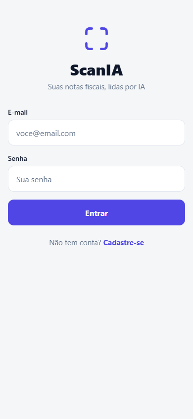
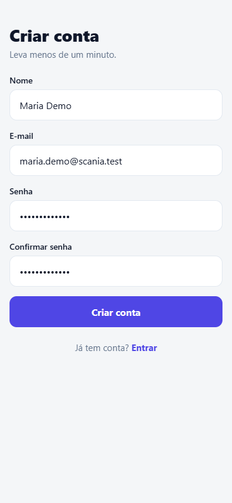
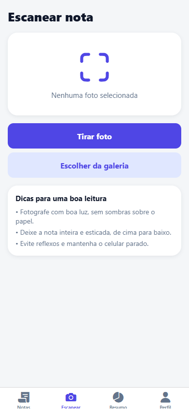
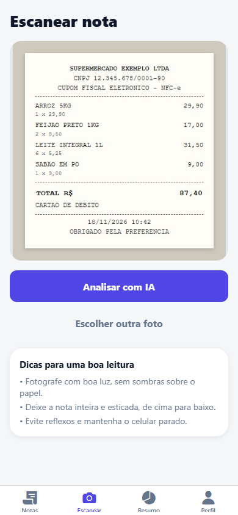
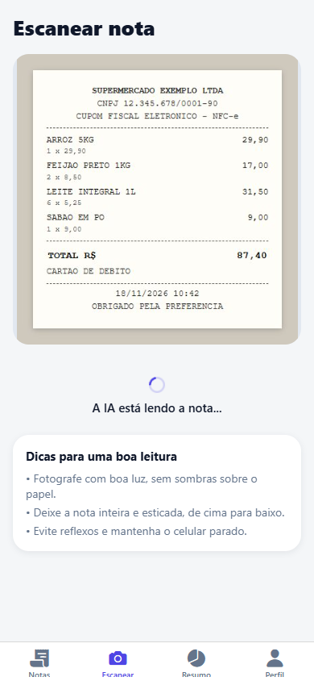
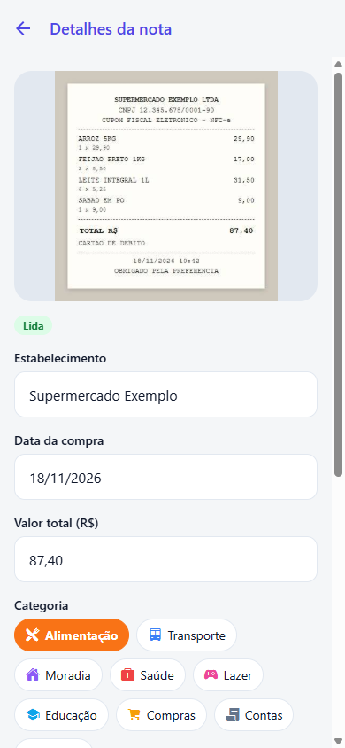
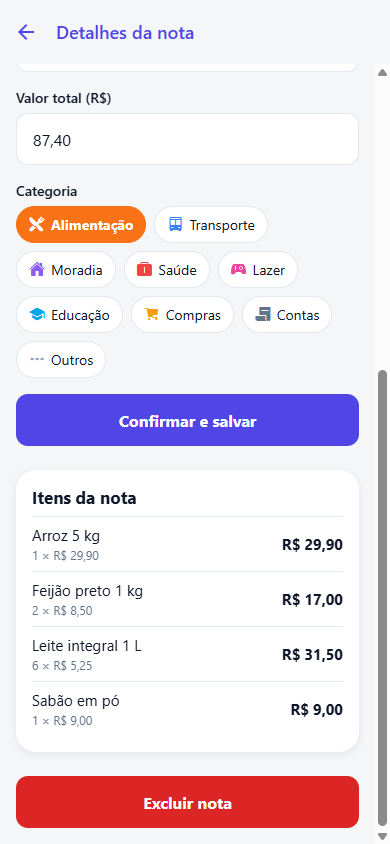
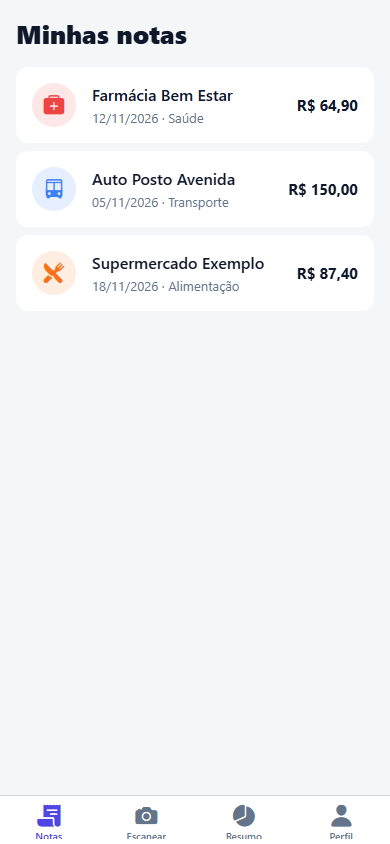
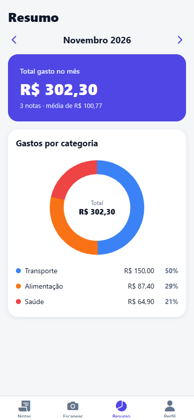
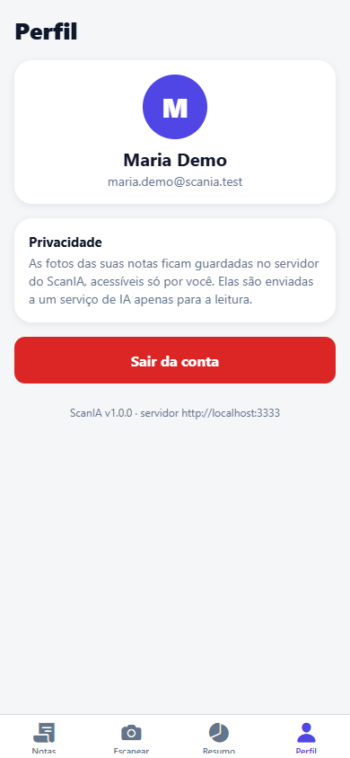

# ScanIA

Aplicativo mobile que lê notas fiscais com inteligência artificial: fotografe o
cupom e o app extrai estabelecimento, data, valor, categoria e itens. Você revisa,
corrige e acompanha seus gastos por categoria.

Tudo roda **na sua máquina**: um servidor Node pequeno com **SQLite** (o `node:sqlite`
que já vem no Node 24). Sem banco externo, sem nuvem.

## Funcionalidades

- Cadastro, login e sessão persistente (senha com scrypt, token de sessão)
- Captura por câmera ou galeria, com redução da imagem antes do envio
- Leitura da nota por IA no servidor (a chave da IA nunca vai para o app)
- Modo simulado (`MOCK_AI=true`) para testar tudo sem gastar créditos
- Revisão e correção dos dados extraídos (humano no circuito)
- Resumo mensal com gráfico por categoria
- Fotos guardadas no servidor, abertas só por link assinado que expira em 1 hora
- Cada usuário só enxerga as próprias notas

## Telas

Prints do app rodando (modo simulado da IA) com 3 compras de novembro de 2026:
supermercado (R$ 87,40), posto de gasolina (R$ 150,00) e farmácia (R$ 64,90).

### Conta

| Login | Cadastro | Primeiro acesso |
| :---: | :---: | :---: |
|  |  |  |

### Escanear uma nota

| Escolher a foto | Foto escolhida | IA lendo a nota |
| :---: | :---: | :---: |
|  |  |  |

### Revisar e corrigir

O usuário confere o que a IA leu, corrige o que precisar e salva.

| Dados extraídos | Itens da nota |
| :---: | :---: |
|  |  |

### Acompanhar os gastos

O resumo soma as notas do mês e divide por categoria. Em novembro: **R$ 302,30** em
3 notas (média de R$ 100,77), sendo Transporte 50%, Alimentação 29% e Saúde 21%.

| Minhas notas | Resumo do mês | Perfil |
| :---: | :---: | :---: |
|  |  |  |

Os cupons usados nos prints estão em [`docs/cupons-exemplo/`](docs/cupons-exemplo/)
e servem para testar o app sem precisar fotografar uma nota de verdade.

## Tecnologias

React Native · Expo (SDK 58) · Expo Router · TypeScript · Node 24 (`node:http`,
`node:sqlite`) · Claude API (visão) · TanStack Query · React Hook Form · Zod · Jest

## Como executar

Precisa de Node 24 ou mais novo e do app **Expo Go** no celular.

1. Instale as dependências do app e do servidor:

   ```
   npm install
   cd server && npm install && cd ..
   ```

2. Crie o arquivo de configuração do servidor (já vem em modo simulado):

   ```
   cp server/.env.example server/.env
   ```

3. Em um terminal, ligue o servidor:

   ```
   npm run server
   ```

   Ele mostra a porta (3333) e o endereço na rede local. O banco fica em
   `server/data/scania.db` e as fotos em `server/data/uploads/`.

4. Em outro terminal, ligue o app e escaneie o QR Code com o Expo Go:

   ```
   npx expo start
   ```

   O app descobre sozinho o IP do computador. Celular e computador precisam
   estar **na mesma rede Wi-Fi**. Para testar no navegador: `npm run web`.

### Ligar a IA de verdade

No `server/.env`:

```
MOCK_AI=false
ANTHROPIC_API_KEY=sk-ant-...
```

Reinicie o servidor. O modelo padrão é o `claude-haiku-5-5` (rápido e barato para
ler documentos); troque com `ANTHROPIC_MODEL`. A chave fica só no servidor: nunca
coloque no `.env` do app nem no Git.

## Arquitetura

O projeto é organizado **em camadas**: cada camada só conversa com a de baixo.
São funções simples em arquivos separados, sem classes e sem injeção de dependência.

```
App (src/ + app/)                      Servidor (server/src/)
─────────────────                      ──────────────────────
app/          telas (Expo Router)      http/          rotas: HTTP <-> serviços
src/hooks     estado e cache           services/      regras de negócio
src/services  o que pedir ao servidor  repositories/  SQL
src/lib/api   cliente HTTP + sessão    infra/         banco, IA, disco, assinatura
                                       domain/        regras puras e erros
```

```
app/                    telas (Expo Router)
src/
  components/           componentes visuais
  hooks/                TanStack Query: busca, cache e mutações
  services/             uma função por rota do servidor
  lib/api.ts            cliente HTTP do servidor local + sessão no aparelho
  schemas/              validação dos formulários (Zod)
  utils/                dinheiro, datas e resumo do mês (puros, testados)
server/
  src/index.ts          liga o servidor
  src/http/             routes.ts (rotas) e helpers.ts (JSON, CORS, token)
  src/services/         auth.ts (cadastro, login, sessão) e receipts.ts (notas e IA)
  src/repositories/     users.ts e receipts.ts: todo o SQL fica aqui
  src/infra/            db.ts (SQLite), ai.ts (Claude), storage.ts (fotos),
                        signing.ts (links assinados), paths.ts (pastas)
  src/domain/           parse.ts (validação da IA, valores, datas; também no Jest)
                        e errors.ts (HttpError)
  test/api.test.ts      testes de integração (sobem o servidor de verdade)
__tests__/              testes do app (Jest)
docs/                   prints das telas e cupons de exemplo
```

Fluxo de uma leitura:

1. O app reduz a foto e envia para `POST /receipts`. O servidor grava em
   `uploads/<id do usuário>/` e cria a nota com estado `pending`.
2. O app chama `POST /receipts/:id/scan`. O servidor chama a IA, valida a resposta
   com `normalizeReceipt` e grava nota + itens numa transação (`done`), ou marca
   `error` com uma mensagem amigável. Se o usuário salvar uma correção durante a
   leitura, a correção dele vale e o resultado da IA é descartado.
3. O usuário revisa e corrige na tela de detalhes.

### Diferenças em relação ao guia original

O guia usa Supabase (Auth, Postgres com RLS, Storage e Edge Function). Aqui cada
peça virou algo local e simples:

| No guia (Supabase)        | Aqui (local)                                                  |
| ------------------------- | ------------------------------------------------------------- |
| Supabase Auth             | `server/src/services/auth.ts` (scrypt + token aleatório)      |
| Postgres + RLS            | SQLite; toda consulta de nota filtra por `user_id`            |
| Storage privado           | pasta `server/data/uploads/` + link assinado (HMAC, 1 hora)   |
| Edge Function (Deno)      | rota `POST /receipts/:id/scan` no servidor Node               |
| Secrets do Supabase       | `server/.env`                                                 |

## Scripts

| Comando               | O que faz                                       |
| --------------------- | ----------------------------------------------- |
| `npm run server`      | Liga o servidor local (porta 3333)              |
| `npm start`           | Inicia o Expo                                   |
| `npm run web`         | Abre o app no navegador                         |
| `npm test`            | Testes do app e da validação da IA (Jest)       |
| `npm run test:server` | Teste de integração do servidor (sobe e testa)  |
| `npm run typecheck`   | Verifica os tipos do app e do servidor          |
| `npm run lint`        | Procura problemas no código (ESLint do Expo)    |
| `npm run format`      | Formata o código (Prettier)                     |

## Problemas comuns

| Sintoma                                   | Solução                                                                                           |
| ----------------------------------------- | ------------------------------------------------------------------------------------------------- |
| "Sem conexão com o servidor"              | Confira se `npm run server` está rodando e se o celular está no mesmo Wi-Fi                         |
| Funciona no navegador, mas não no celular | O Firewall do Windows pode bloquear a porta 3333: permita o Node na rede privada                  |
| Servidor em outra máquina                 | Defina `EXPO_PUBLIC_API_URL=http://IP:3333` no `.env` da raiz e reinicie com `npx expo start -c` |
| "Muitas tentativas" no login              | 5 senhas erradas seguidas travam o e-mail por 15 minutos. Espere ou reinicie o servidor          |
| "Falha ao processar a nota" sempre        | Veja o terminal do servidor. Confira `MOCK_AI` e `ANTHROPIC_API_KEY` no `server/.env`              |
